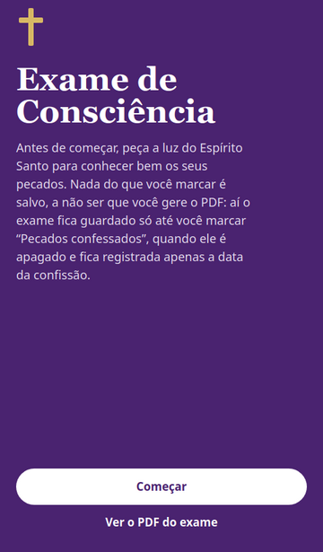
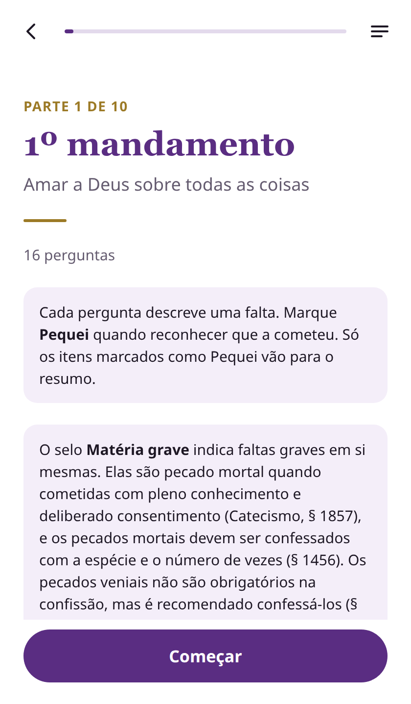
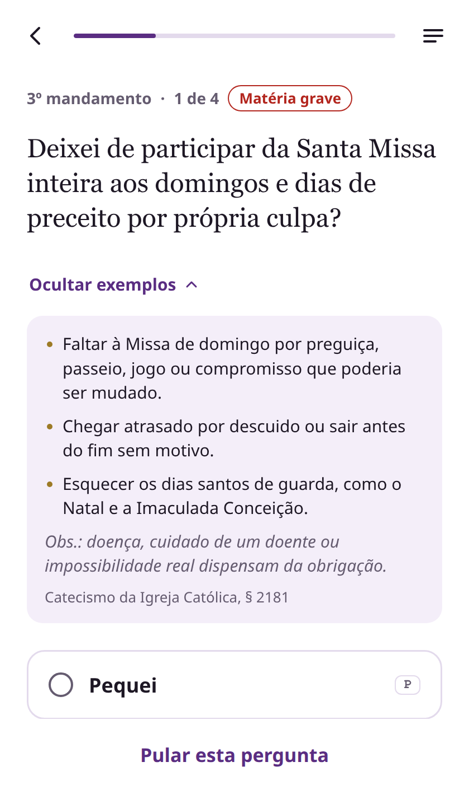
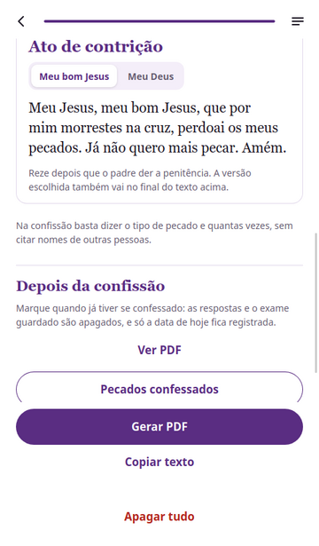

# Confiteor

Um **exame de consciência católico** para Linux, em formato de formulário passo a passo: uma pergunta por tela, com exemplos didáticos, e no final um texto pronto para levar à confissão.

Funciona **100% offline**: nada vai para a internet. As respostas ficam só na memória e se apagam ao fechar a janela, **a não ser que você gere o PDF**: aí o exame fica guardado no seu computador só até você marcar **"Pecados confessados"**, quando tudo é apagado e fica registrada apenas a data da confissão. Veja os detalhes em [Privacidade](#privacidade).

<p align="center">
  
  
  
  
</p>

## O que ele faz

- **Começa por três perguntas**: estado de vida, filhos e última confissão. Assim o exame mostra só o que vale para você, e o texto final já começa com o tempo desde a última confissão, calculado a partir da data.
- **Segue os 10 mandamentos, os mandamentos da Igreja e os pecados capitais**, num total de 103 perguntas, todas escritas como uma falta: marcar **Pequei** quer dizer "sim, cometi isso".
- **Tem exemplos em cada pergunta** ("Ver exemplos"), com observações que ajudam a evitar escrúpulos, como explicar que distrações involuntárias não são pecado.
- **Ao marcar Pequei**, você pode anotar quantas vezes, uma observação (detalhes para consultar se o padre perguntar) e se esqueceu de confessar isso em confissão anterior.
- **O resumo final** traz:
  - um **texto para a confissão** editável, ordenado dos pontos mais graves para os mais leves;
  - uma lista por mandamento;
  - o **ato de contrição**, em duas versões;
  - **Gerar PDF** (app instalado): um PDF A4 para levar à confissão, com a data por extenso, "Padre, minha última confissão foi há dois meses", os pecados agrupados por mandamento (a quantidade por extenso e a observação embaixo, em letra menor), a seção "Por último" com o que foi esquecido em confissão anterior, o encerramento e o ato de contrição;
  - **Ver PDF** (app instalado): abre o PDF numa janela do próprio app, com um botão "Pecados confessados" no topo. Se o app não gerou nenhum PDF, você escolhe um (por exemplo, um que montou à mão); o caminho fica só na memória até a confissão. A janela não acessa a rede e bloqueia downloads;
  - **Pecados confessados** (app instalado): depois de se confessar, apaga as respostas, o exame guardado e, se você quiser, o PDF, e registra só a data.
- **A tela inicial tem "Ver o PDF do exame"** (app instalado) **e mostra a última confissão** registrada ("Última confissão: 22/11/2026 (há 3 dias)"), e a data já vem preenchida no exame.
- **Atalhos de teclado**: `P`/`N` respondem, `E` abre os exemplos, `Enter` continua, `←` volta e `Esc` fecha os menus.
- **Tema claro e escuro**, que segue o sistema.

## Privacidade

O Confiteor foi feito para que **o seu exame não fique registrado além do necessário**:

- não acessa a internet, e qualquer navegação para fora do app é bloqueada;
- a página não grava nada: sem `localStorage`, cookies nem cache em disco (a sessão do WebKit é efêmera);
- enquanto você não gera o PDF, tudo fica só na memória e some ao fechar a janela;
- o botão "Copiar texto" só copia para a área de transferência quando você clica nele.

No app instalado, **só por ação sua**, o `confiteor.py` grava, sempre com permissão `600` (só o seu usuário lê):

| Arquivo | Quando | Até quando |
|---|---|---|
| o PDF, onde você escolher | ao clicar em **Gerar PDF** | até você apagá-lo; em **Pecados confessados** o app oferece apagar |
| `~/.local/share/confiteor/exame-atual.json` | ao gerar o PDF, para não perder o exame se fechar o app | **Pecados confessados** ou **Apagar tudo** |
| `~/.local/share/confiteor/confissoes.json` | em **Pecados confessados** | permanente: guarda **só a lista de datas** |

A página não tem acesso ao disco: ela só pode pedir ao `confiteor.py` para gerar o PDF, abrir um PDF para leitura, registrar a confissão ou apagar o exame guardado, e ele valida cada pedido. Um PDF escolhido em "Ver PDF" não é copiado nem registrado: o app lembra o caminho só na memória, até a confissão.

**Depois de se confessar, apague os PDFs.** O botão "Pecados confessados" oferece apagar o PDF que o app conhece (o gerado ou o aberto em "Ver PDF"); outras cópias, em Downloads ou num pendrive, por exemplo, ficam por sua conta. Aberto direto no navegador, o app não grava nada, e os botões "Gerar PDF" e "Pecados confessados" avisam que só funcionam no app instalado.

## Instalação

### 1. Dependências

O app usa Python 3 e WebKitGTK, que já vêm instalados em muitas distribuições com GNOME. Se faltar algo:

```bash
# Ubuntu / Debian / Mint / Pop!_OS
sudo apt install python3-gi gir1.2-webkit2-4.1

# Fedora
sudo dnf install python3-gobject webkit2gtk4.1

# Arch / Manjaro
sudo pacman -S python-gobject webkit2gtk-4.1
```

Se o WebKitGTK não estiver disponível, o comando `confiteor` abre o app no Chromium, Chrome ou Brave em modo aplicativo, com um perfil temporário que é apagado ao fechar. Em último caso, abre no navegador padrão.

### 2. Instalar

```bash
git clone https://github.com/JaelsonJonas/confiteor.git
cd confiteor
./install.sh
```

A instalação é **só para o seu usuário** e não precisa de `sudo`. Ela cria:

| Caminho | Conteúdo |
|---|---|
| `~/.local/share/confiteor/` | o app (`confiteor.html`, `css/`, `js/`, `confiteor.py`, ícones) |
| `~/.local/bin/confiteor` | o comando de terminal |
| `~/.local/share/applications/confiteor.desktop` | o atalho no menu de aplicativos |
| `~/.local/share/icons/hicolor/…/confiteor.*` | o ícone (SVG e PNG 512) |

## Como usar

- **Pelo menu**: aperte a tecla Super e procure por **Confiteor**.
- **Pelo terminal**: `confiteor`
- **Sem instalar**: baixe a pasta inteira do projeto (com `git clone` ou pelo botão *Code → Download ZIP* do GitHub) e abra o `confiteor.html` em qualquer navegador. Funciona offline, em qualquer sistema operacional, mas **sem** "Gerar PDF", "Ver PDF", "Pecados confessados" e o histórico de datas, que dependem do app instalado. Nesse modo, nada é gravado. O `confiteor.html` sozinho não funciona: ele precisa das pastas `css/` e `js/` ao lado.

**Fluxo sugerido no app instalado:** faça o exame → **Gerar PDF** → leve o PDF (ou o texto) à confissão → depois, **Ver PDF** ou o Resumo → **Pecados confessados**.

## Atualizar ou remover

```bash
cd confiteor
git pull && ./install.sh   # atualizar
./uninstall.sh             # remover
```

O `uninstall.sh` remove o app e **pergunta** antes de apagar os seus dados: o exame guardado (padrão: apagar) e o histórico de datas das confissões (padrão: manter).

## Estrutura do projeto

```
confiteor.html          # estrutura da página (abre direto no navegador, sem servidor)
css/app.css             # visual: cores, telas, temas claro e escuro
js/dados/perguntas.js   # as 103 perguntas, por seção
js/dados/exemplos.js    # exemplos e observações de cada pergunta
js/dados/oracoes.js     # atos de contrição
js/logica.js            # regras sem interface: texto da confissão, tempo desde a data, telas
js/app.js               # interface: telas, navegação, teclado, copiar
tests/                  # testes automatizados (node --test)
confiteor.py            # janela nativa (GTK + WebKitGTK, sessão efêmera); gera o PDF, abre o visualizador
                        # e grava, a pedido da pessoa, o exame até a confissão e as datas (permissão 600)
install.sh, uninstall.sh
```

Não há etapa de build nem dependências: são scripts comuns carregados em ordem pelo `confiteor.html`.

### Como contribuir

- **Corrigir uma pergunta ou um exemplo**: edite `js/dados/perguntas.js` ou `js/dados/exemplos.js`. O id de cada pergunta é `seção-grupo-pergunta` (ex.: `0-0-5`) e liga a pergunta aos exemplos.
- **Mudar a ordem ou as frases do texto da confissão**: edite `js/logica.js` (`MATERIA_GRAVE`, `FRASES_CAPITAIS`, `JUNCOES`).
- **Rodar os testes** (precisa do Node.js 20 ou mais recente e do Python 3):

  ```bash
  node --test tests/                      # dados, regras do exame, texto e PDF
  python3 -m unittest discover -s tests   # arquivos gravados pelo confiteor.py
  ```

  Os testes conferem os dados (por exemplo, se toda pergunta tem exemplos) e as regras (ordem do texto, data relativa, perguntas que dependem do perfil). Eles também rodam automaticamente no GitHub a cada push e pull request.

## Aviso

O Confiteor é uma ajuda para a preparação pessoal e **não substitui a orientação de um sacerdote**. Os exemplos e as observações têm fins didáticos. Em caso de dúvida sobre a gravidade de um pecado ou sobre a forma de se confessar, converse com um padre.

Como o PDF e o exame guardado contêm os seus pecados, trate-os como documentos íntimos: não os envie por e-mail ou mensagem, não os guarde em pastas sincronizadas com a nuvem e apague-os depois da confissão.

## Licença

[MIT](LICENSE)
